<picture>
  <source media="(prefers-color-scheme: dark)" srcset="assets/loop-dark.svg">
  
</picture>

### Hi, I'm Peter 👋

Senior Software Engineer at MercadoLibre, based in Bogotá. 9+ years building APIs, distributed systems and AI-integrated platforms across fintech, cybersecurity, e-commerce and logistics. Mostly backend, often leading the design.

**[theboshy.github.io](https://theboshy.github.io)** · [LinkedIn](https://linkedin.com/in/peter-lobo) · [Stack Overflow](https://es.stackoverflow.com/users/9206/theboshy) · petergldev@gmail.com

#### How I work

**Docs before code.** Decisions recorded as ADRs. Phases with exit criteria. Security as a design input. AI in the loop, not at the wheel.

#### Stack

`TypeScript` `Node.js` `NestJS` `Java` `Kotlin` `Spring Boot` `Go` `PostgreSQL` `DynamoDB` `OpenSearch` `Redis` `AWS` `Docker` `Kubernetes`

The diagram above is generated from the same data as my site: [source](https://github.com/theboshy/theboshy.github.io).
